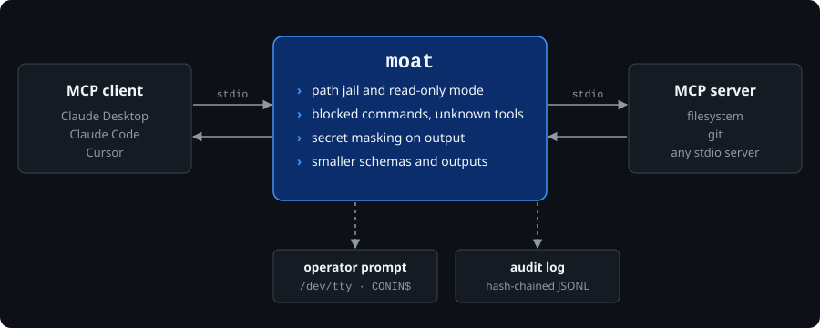
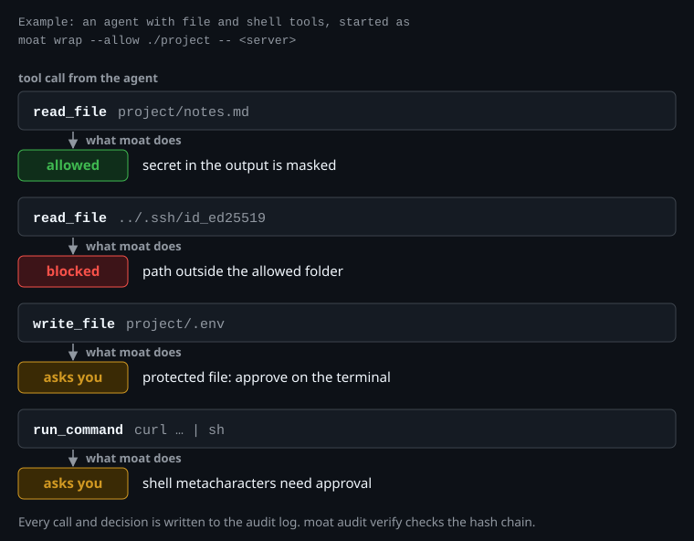

# mcp-moat (`moat`)

[](https://crates.io/crates/mcp-moat)
[](https://github.com/gencay-e/mcp-moat/blob/main/LICENSE)
[](https://github.com/gencay-e/mcp-moat/actions/workflows/ci.yml)

A policy proxy for MCP servers, written in Rust. `moat` sits between an MCP client (for example Claude Desktop, Claude Code, Cursor) and an MCP server that talks JSON-RPC over stdio. It checks tool calls against a policy, masks secrets in server output, can ask the operator before sensitive actions, and can reduce the size of tool schemas and outputs.



`moat` filters stdio traffic and prompts the operator, but it does not sandbox the server process itself. Read [SECURITY.md](https://github.com/gencay-e/mcp-moat/blob/main/SECURITY.md) for what it does not protect against, and [CHANGELOG.md](https://github.com/gencay-e/mcp-moat/blob/main/CHANGELOG.md) for the current release (`0.3.0`).

---

## What it does




A real run of moat in front of `@modelcontextprotocol/server-filesystem`, allowed folder `/srv/demo/project`. The verdict lines are shortened from moat's responses; `scripts/demo.py` drives the run and checks each line against the real output. The scripted MCP client read `notes.md` (which holds a key), tried to read `../.ssh/id_ed25519` outside the folder, and tried to write `project/.env`, which was denied because `--no-prompt` is set:

```text
$ moat audit query audit.jsonl --violations-only
#4 [Outbound] method=dlp_redaction -> - [DLP: 4 redacted]
#5 [Inbound]  method=tools/call   tool=read_file    -> BLOCK (Path outside boundary: path '/srv/demo/.ssh/id_ed25519' is not within allowed root '/srv/demo/project')
#6 [Inbound]  method=tools/call   tool=write_file   target=/srv/demo/project/.env -> ASK_OPERATOR [Operator: Deny] (Attempted modification of protected configuration/hook: /srv/demo/project/.env)

$ moat audit verify audit.jsonl
[moat] Audit Log Integrity Check: PASSED
  Path:                  audit.jsonl
  Verified Records:      6
  Cryptographic Chain:   INTACT (SHA-256)
```

The output is from a run of `scripts/demo.py` and is shortened (timestamps and empty columns removed, the temporary folder replaced by `/srv/demo`). The scripted MCP client got `OPENAI_API_KEY=[MCP-MOAT-REDACTED-SECRET]` instead of the key.

### Policy checks

* **Path jail.** File paths in tool calls must stay inside the directories given with `--allow` (or `allowed_paths` in `moat.toml`). Paths with `..`, percent-encoded or double-encoded traversal, and `file://` URIs for `resources/read` and `resources/subscribe` are checked the same way. The jail is checked first: a call with a path outside the jail is blocked whatever the tool name or the other arguments are, also when it carries a command.
* **UNC and NT paths.** Paths starting with `\\`, `//`, `\??\`, `/??/`, `\device\` or `/device/` are rejected before any file system access, as are the `\GLOBAL??\`, `\GLOBALROOT\`, `\DosDevices\`, `\SystemRoot\`, `\BaseNamedObjects\`, `\ArcName\` and `\KernelObjects\` namespaces. Separators are normalized first, so mixed forms such as `\/?\C:\` are caught too. This is a text check. It has not been verified against a real SMB or NTLM scenario on Windows.
* **Protected files.** Writes to files such as `.git`, `.gitmodules`, `.gitconfig`, `.env`, `moat.toml`, `.vscode`, `.github`, the audit log, SSH keys and AWS credentials always need operator approval. The file passed to `--config` is added to this list automatically, so an agent cannot rewrite the policy that guards it.
* **Read-only mode.** `--read-only` blocks tools that look like they modify files, based on tool name prefixes and suffixes, and tools listed in `custom_modifying_tools`.
* **Blocked commands.** `blocked_commands` and `blocked_commands_regex` reject shell commands. Literal rules are tokenized: whitespace is collapsed, path prefixes such as `/bin/rm` are resolved to the program name, and combined short flags are compared as sets. `rm  -rf /`, `rm -r -f /`, `/bin/rm -fr /` and `sudo rm -rf /` are blocked, while `rm -rf /tmp/build` goes to the operator prompt. This is not a complete shell parser, see [SECURITY.md](https://github.com/gencay-e/mcp-moat/blob/main/SECURITY.md).
* **Shell metacharacters.** Command arguments with `|`, `&`, `;`, `$`, backticks, `<`, `>` or control characters are not blocked outright. They need operator approval. PowerShell encoded-command flags are blocked.
* **Reserved device names.** Path segments such as `CON`, `NUL`, `AUX`, `COM1` are rejected on all platforms. On Linux and macOS this also rejects real directories with these names.
* **Symlinks and hardlinks.** Paths are resolved and checked against the jail. Hardlink checks (link count above 1) exist on Unix only. Symlinks to the outside are tested on Linux by `scripts/real_server_check.py`, not on macOS or Windows. A change between the check and the use of a file cannot be ruled out.
* **Batch requests.** JSON-RPC batch arrays are rejected.

### Secret masking

Output from the server (`stdout` and `stderr`) is scanned and known secret formats are replaced with `[MCP-MOAT-REDACTED-SECRET]`. Covered formats include OpenAI keys (including `sk-proj-`, `sk-svcacct-` and `sk-admin-`), Anthropic, DeepSeek, Mistral (with `mistral` context), Perplexity, Voyage AI, Cohere, Google AI Studio keys, GitHub tokens, GitLab tokens, Slack tokens, Stripe keys, npm and PyPI tokens, Hugging Face tokens, AWS access keys and temporary session keys (`ASIA...`), AWS secret access keys next to `aws` or `secret`, bearer tokens and PEM private key blocks. Unicode-escaped variants (`\u0073\u006b-...`) are decoded before matching.

`dlp_base64_heuristic = true` in `moat.toml` also masks long Base64 and Base64url runs with upper case, lower case and digits. It is off by default because it also masks image and audio data, file paths, lockfile hashes, long identifiers and public keys, which breaks those responses.

Not covered: secrets in other formats, Base64-encoded secrets (unless the heuristic is on), and secrets split across several messages.

### Operator prompts

For actions that need approval, `moat` asks on the terminal device directly (`/dev/tty` on Unix, `CONIN$` on Windows), so the JSON-RPC stream on stdin and stdout is not disturbed. File changes are shown as a diff. `[a]llow always` remembers the decision for the session. For shell tools the decision is remembered per exact action only. With `--no-prompt`, every action that needs approval is denied, and the block message says that `--no-prompt` is the reason.

### Stream handling

* Lines longer than 16 MB are dropped and answered with a JSON-RPC error.
* `stderr` of the child process is drained in its own task, so the child cannot block on a full pipe.
* `ping` requests are passed on with priority.
* On Ctrl+C the child process is terminated and `moat` exits with code 130.
* `--monitor` (alias `--audit-only`) does not block. It forwards everything and logs what would have been blocked. The terminal diagnostic names the tool and a fixed category (for example "path outside allowed folder"), never the path from the request.

### Audit log

`--audit-log <file>` writes one JSON line per event. Each line contains the SHA-256 hash of the previous line (`prev_hash`). `moat audit verify <file>` checks the chain and reports the first broken line.

What this detects: changing, reordering or deleting a line in the middle of a session.

What this does not detect: cutting lines off the end, deleting a whole session, deleting the file, or rebuilding a log from scratch. The hash is not keyed and there is no external anchor. Do not treat the log as tamper-proof evidence. Previews in the log are passed through the secret masking.

If the audit log cannot be written, the call is not forwarded (fail closed).

Other commands: `moat audit query <file> --violations-only`, `moat audit query <file> --tool <name>`, `moat audit tail <file> -f`.

### Schema and output reduction (`--compact-schemas`, `--max-output-bytes`, `--hide-tool`)

* `--compact-schemas` removes metadata such as `$schema`, `title`, `examples` and long descriptions from `tools/list` responses. With `--read-only`, tools that modify files are removed from the list.
* `--max-output-bytes <N>` cuts text output of a tool or resource to N bytes and adds a marker.
* `--hide-tool <name>` removes a tool from `tools/list` and blocks calls to it.

How much this saves depends on the server. No fixed percentage is claimed.

### Code generation (`moat codegen`)

Reads `tools/list` from a running server or from a JSON file, applies the policy (hidden tools, read-only), and writes TypeScript declarations (`--format ts`), Python stubs (`--format python`) or a Markdown table (`--format compact-md`).

---

## Install

```bash
cargo install --locked mcp-moat
```

### From a release

1. Download the archive for your system and `SHA256SUMS` from the [Releases page](https://github.com/gencay-e/mcp-moat/releases).
2. Check the hash.

   Linux:
   ```bash
   sha256sum -c SHA256SUMS --ignore-missing
   ```

   macOS:
   ```bash
   shasum -a 256 -c SHA256SUMS --ignore-missing
   ```

   Windows (PowerShell): compare the output of
   ```powershell
   Get-FileHash .\moat-windows-x86_64.zip -Algorithm SHA256
   ```
   with the line in `SHA256SUMS`.
3. Unpack the archive and put `moat` (`moat.exe`) on your `PATH`.

Archives are built for Linux x86_64, macOS aarch64, macOS x86_64 and Windows x86_64. They are not signed.

### From source

```bash
cargo build --release --locked --bin moat
```

The binary is `target/release/moat` (`moat.exe` on Windows).

---

## Usage

Create a commented `moat.toml` in the current directory:

```bash
moat init
```

Wrap an MCP server. Everything after `--` is the server command.

```bash
# Filesystem server, limited to the current directory
moat wrap --preset filesystem -- npx -y @modelcontextprotocol/server-filesystem .

# Git server
moat wrap --preset git -- python -m mcp_server_git

# Read-only
moat wrap --preset filesystem --read-only -- npx -y @modelcontextprotocol/server-filesystem .

# No prompts: deny everything that needs approval (for CI)
moat wrap --preset filesystem --no-prompt -- npx -y @modelcontextprotocol/server-filesystem .

# With audit log
moat wrap --preset filesystem --audit-log .moat/audit.jsonl --audit-level full -- npx -y @modelcontextprotocol/server-filesystem .
```

Presets: `filesystem`, `git`, `fetch`, `sqlite`, `memory`.

### Configuration (`moat.toml`)

`moat` reads `moat.toml` from the current directory, or the file given with `--config`.

```toml
# Allowed root paths for filesystem access.
allowed_paths = ["."]

# Block all tools that look like they modify files.
read_only = false

# Require operator approval for writes inside allowed directories.
# Protected files always require approval.
require_approval_on_write = false

# Shell command patterns that are blocked (tokenized match).
blocked_commands = [
    "rm -rf /",
    ":(){ :|:& };:",
    "mkfs",
    "dd if=/dev/zero",
    "format c:",
    "powershell -enc",
]

# Tools that never need approval. A tool that moat does not know is blocked until it is listed
# here (or covered by a preset). custom_modifying_tools only classifies a tool, it does not allow it.
always_allow_tools = [
    "list_directory",
    "read_file",
    "search_files",
    "grep",
]

# Tools with a file-like name (get_*, read_*, ...) that take no path, for example "get-sum".
# Otherwise they are blocked, because moat finds no path to check.
# non_file_tools = ["get-sum"]

# Argument names that look like paths but are not. Ignored for every tool. The git and memory
# presets ignore their keys for their own tools only.
# ignore_path_keys = ["target"]

compact_schemas = false
# max_output_bytes = 16384
hidden_tools = []

# Extra JSON-RPC methods to forward (exact match). Only the standard MCP client-to-server
# methods are forwarded by default; any other method is refused (-32601).
# allowed_methods = ["x/vendor_method"]

# Mask long Base64 runs as possible secrets. Off by default, see "Secret masking".
# dlp_base64_heuristic = false

# Extra files that always require approval. The active --config file is added automatically.
# protected_files = ["important.txt"]
```

### Validate a configuration (`moat check`)

`moat check` parses the TOML, verifies that every `allowed_paths` entry exists and is a directory, checks the audit-log path, and compiles the blocked-command regexes. It does not start a server.

```bash
moat check
moat check --config ./configs/strict.toml
```

The command prints `Config OK: <source>` and the resolved allowed roots. It exits non-zero with a specific error when a path or regex is invalid.

### Shell completions (`moat completion`)

```bash
moat completion bash
moat completion zsh
moat completion fish
moat completion powershell
```

Pipe the output to your shell's completion directory, for example:

```bash
moat completion bash > ~/.local/share/bash-completion/completions/moat
```

### Claude Desktop

Edit `claude_desktop_config.json` (Windows: `%APPDATA%\Claude\`, macOS: `~/Library/Application Support/Claude/`):

```json
{
  "mcpServers": {
    "protected-filesystem": {
      "command": "C:\\path\\to\\moat.exe",
      "args": [
        "wrap",
        "--allow", "C:\\Projects\\MyProject",
        "--",
        "npx", "-y", "@modelcontextprotocol/server-filesystem", "C:\\Projects\\MyProject"
      ]
    }
  }
}
```

### Cursor

`.cursor/mcp.json`:

```json
{
  "mcpServers": {
    "guarded-git": {
      "command": "moat",
      "args": ["wrap", "--allow", ".", "--read-only", "--", "mcp-server-git"]
    }
  }
}
```

---

## Tested against real MCP servers

`scripts/real_server_check.py` starts mcp-moat in front of three real servers and checks 58 cases (56 on Windows, where the two symlink cases are skipped). It needs Node.js, Python and git, and runs in CI on Linux.

* `@modelcontextprotocol/server-filesystem`: reads inside and outside the jail, `..`, symlinks to the outside, protected files, read-only mode, secret masking, audit chain.
* `mcp-server-git`: this server does not restrict itself. It reads any repository you name. mcp-moat keeps it inside the allowed folder, including relative file lists such as `files: ["src/main.rs"]`, which are checked against `repo_path`.
* `@modelcontextprotocol/server-everything`: a tool that dumps the environment (`get-env`) has its secrets masked; tools that are not on the allow list are blocked.

The servers are pinned: `@modelcontextprotocol/server-filesystem@2.3.0`, `@modelcontextprotocol/server-everything@2.3.0` and `mcp-server-git==2026.11.11` (also in `scripts/demo.py` and the CI workflow). Update the pins on purpose and run the check again. Other MCP servers and versions were not tested.

### Good to know

* **Order of checks.** (1) hidden tool, (2) path jail for every path argument, (3) file tool without a path, (4) modifying tool in read-only mode, (5) tool that is not authorized and does not modify, (6) blocked command, (7) any other command argument, (8) modifying tool with a protected file, `require_approval_on_write` (also without a path) or no authorization. The first match wins; the full table is in `docs/security-model.md`. A path outside the jail is always a block, never a prompt.
* **Authorization.** A tool is allowed without the operator only if it is listed in `always_allow_tools` or `custom_always_allow_tools`, is enabled by a preset, or has the exact name of a tool of `@modelcontextprotocol/server-filesystem` (`read_file`, `read_text_file`, `read_media_file`, `read_multiple_files`, `write_file`, `edit_file`, `append_file`, `copy_file`, `create_directory`, `list_directory`, `list_directory_with_sizes`, `directory_tree`, `move_file`, `search_files`, `get_file_info`, `list_allowed_directories`). A name that only looks like a file tool (`read_*`, `write_*`, `get_*`) or a look-alike (`rm`, `cat`, `shred`, `delete_file`) never authorizes a tool. An unlisted tool that modifies needs operator approval (denied with `--no-prompt`), any other unlisted tool is blocked. List the tool in `always_allow_tools` or `custom_always_allow_tools` to allow it.
* **Classification is not authorization.** `custom_modifying_tools` marks a tool as modifying: `--read-only` blocks it and it counts as a write. It does not allow the tool. Add the tool to `always_allow_tools` as well if it should run without a prompt.
* **Commands.** A call with a command argument is never allowed automatically. It is blocked (blocked command) or needs operator approval. A tool that is not authorized and does not modify is blocked before its command is looked at.
* **Tools without a path.** Tools with a file-like name that take no path (`get-sum`) need `non_file_tools = ["get-sum"]`, otherwise mcp-moat blocks them because it finds no path to check. This includes calls without arguments. `list_allowed_directories` is exempt. `non_file_tools` does not allow a tool; paths that are present are still checked. The presets list their own pathless tools (see below).
* **URLs and paths.** Only local paths and `file://` URIs are checked as paths. An `http://` or `https://` URL in a URL argument (`url`, `uri`, `href`, `*_url`) is not a path and is not jail-checked. The tool that fetches it must still be authorized (listed or enabled by a preset). An `http(s)` URL in a path argument (`path`, `file`) is rejected, and `file://` URLs and bare paths in a URL argument are jail-checked.
* **Presets.** `filesystem`: read tools and the standard filesystem tools are allowed, `delete_file` needs approval. `git`: read tools, `git_add`, `git_commit`, `git_create_branch` and `git_checkout` are allowed; `git_push`, `git_reset` and `git_merge` need approval. `fetch`: sets `read_only`, so `http_post`, `http_put`, `http_delete` and `http_patch` are blocked; `fetch`, `http_get`, `read_url` and `web_search` are allowed. `sqlite`: `read_query`, `list_tables`, `describe_table` and `show_schema` are allowed, `write_query`, `execute_query`, `create_table` and `drop_table` need approval. `memory`: `read_graph`, `search_nodes` and `open_nodes` are allowed, the tools that create, delete or add need approval. The pathless tools of `sqlite`, `memory` and `fetch` are exempted from the path requirement by the preset, not by their name. Without the preset they are unknown tools.
* Argument names that look like paths but are not can be listed in `ignore_path_keys`. That is an operator decision: the keys are ignored for every tool of the policy. The presets ignore keys for their own tools only: git for `target`, `revision`, `branch_name` and similar (on `git_*` tools), memory for `from` and `to` (on the memory tools).
* New files in directories that do not exist yet are blocked, because the parent folder cannot be resolved. Create the folder first.

## Platform status

* **Linux:** the test suite passes (`cargo test --workspace --all-targets`).
* **macOS and Windows:** the same tests run in CI. Windows-specific protections (UNC, NT namespace, reserved device names, `CONIN$`) and macOS terminal handling have not been checked by hand on real systems. Treat them as partly tested.
* Hardlink checks work on Unix only.

## Development

```bash
cargo fmt --all -- --check
cargo clippy --workspace --all-targets --all-features -- -D warnings
cargo test --workspace --all-targets --all-features
```

Two PowerShell scripts drive the release binary against the built-in mock server (`cargo build --release --bin moat --bin mock_server` first):

* `scripts/redteam_simulation.ps1`: 33 attack cases (UNC and NT paths, shell injection, traversal, read-only mode, audit log).
* `scripts/dry_run_simulation.ps1`: monitor mode and the `--strict` audit gate.

They default to the Windows paths under `target\release`. On Linux and macOS pass `-MoatPath`/`-MockServerPath` (redteam) or `-MoatBin`/`-MockBin` (dry run).

Crates:

| Crate | Content |
|---|---|
| `mcp-moat-core` | policy engine, path checks, secret masking, audit chain |
| `mcp-moat-proxy` | stdio proxy, mock server for tests |
| `mcp-moat-tty` | terminal prompts, diffs, approval cache |
| `mcp-moat-cli` | the `moat` binary |

## License

MIT, see [LICENSE](https://github.com/gencay-e/mcp-moat/blob/main/LICENSE). Created by [Gencay](https://github.com/gencay-e).
